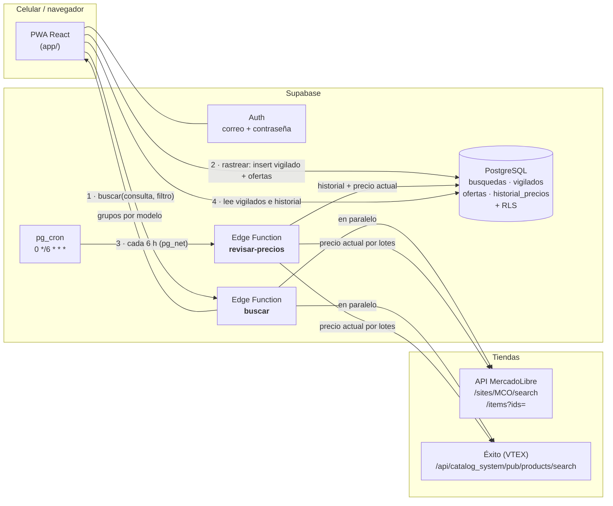

# RastreaYCompra

App para seguir precios en tiendas de Colombia y comprar cuando bajen.
Escribes un producto, ves las coincidencias **agrupadas por modelo**, eliges qué ofertas
seguir, fijas un **precio objetivo**, y la app revisa los precios **cada 6 horas** y guarda
el historial por tienda.

> **Estado: fase 1.** Tiendas activas: **MercadoLibre** (nuevo y usado) y **Éxito** (VTEX).
> Alertas, el resto de tiendas, Amazon/AliExpress y el APK vienen en las fases siguientes.
> El diseño sigue el mockup aprobado en [`mockup/`](mockup/index.html).

---

## 1. Arquitectura en una imagen



Tres ideas sostienen el diseño:

1. **Las tiendas solo se tocan desde el servidor** (Edge Functions). El celular nunca habla con
   MercadoLibre ni con Éxito: así evitamos bloqueos de CORS, escondemos credenciales y podemos
   cambiar un conector sin publicar otra versión de la app.
2. **Un conector = un traductor.** Cada tienda devuelve su JSON a su manera; el conector lo
   convierte a una `Oferta` común (`supabase/functions/_shared/tipos.ts`), siempre en pesos y con
   el **precio final** ya calculado. Agrupar, guardar y graficar no saben de qué tienda vino.
3. **La base de datos se defiende sola.** Con Row Level Security cada usuario solo ve lo suyo, y
   los precios solo los escribe el servidor. Si la app tuviera un error, no podría falsear un
   historial ni leer el de otra persona.

## 2. Qué pasa en cada paso

### Paso 1 · Buscar (`supabase/functions/buscar`)

1. Recibe `{ consulta: "rtx 5060", filtro: "nueva" | "usada" | "ambas" }` con el token del usuario.
2. Llama a todos los conectores **en paralelo**, cada uno con 12 s de límite. Si una tienda falla,
   la búsqueda sigue con las demás y la app muestra cuál no respondió.
3. Junta todas las ofertas y las pasa por `agrupar()` (ver sección 3).
4. Guarda la búsqueda en `busquedas` (alimenta "Búsquedas recientes").

| Tienda | Endpoint | Filtro nueva/usada | Qué se guarda como id |
|---|---|---|---|
| MercadoLibre | `GET api.mercadolibre.com/sites/MCO/search?q=…&condition=new\|used&limit=50` | parámetro `condition` | id de la publicación (`MCO…`) |
| Éxito | `GET www.exito.com/api/catalog_system/pub/products/search?ft=…&_from=0&_to=49` | solo vende nuevo | `skuId` (lo que exactamente se compra) |

En VTEX un producto tiene varios SKU (color, capacidad) y cada SKU puede venderlo más de un
seller del marketplace. El conector toma el seller **con stock y menor precio**.

### Paso 2 · Rastrear (desde la app)

La app inserta directamente en `vigilados` (el modelo, con su precio objetivo) y en `ofertas`
(cada publicación elegida). Un **trigger** escribe el primer punto del historial con el precio del
momento, así la gráfica tiene dato desde el minuto cero.

### Paso 3 · Revisar cada 6 horas (`supabase/functions/revisar-precios`)

`pg_cron` ejecuta a las 00:00, 06:00, 12:00 y 18:00 UTC (7 p. m., 1 a. m., 7 a. m. y 1 p. m. en
Colombia) un `net.http_post` hacia la función, con un secreto propio en la cabecera `x-cron-secret`.
La función:

- agrupa las ofertas activas por conector y pide los precios **por lotes** (MercadoLibre: 20 ids por
  llamada con `/items?ids=`; VTEX: 25 SKU por llamada con `fq=skuId:`),
- guarda una fila en `historial_precios` por oferta y actualiza el precio actual,
- si una publicación no aparece **3 revisiones seguidas**, la marca como no disponible,
- si una tienda entera falla, no toca sus ofertas y se reintenta en 6 h.

El botón **"Revisar ahora"** de la app llama la misma función con el token del usuario; en ese
caso solo revisa sus propias ofertas.

### Paso 4 · Ver (desde la app)

La app lee `vigilados → ofertas → historial_precios` de los últimos 90 días en una sola consulta
y calcula en el celular: mejor precio de hoy, variación a 30 días, mínimo histórico y promedio.

## 3. Cómo se agrupan los resultados por modelo

Archivo: `supabase/functions/_shared/agrupar.ts`. Sin IA ni librerías, para que sea predecible y
se pueda probar.

1. **Normalizar el título**: minúsculas, sin tildes, `8 GB` → `8gb`, `165 Hz` → `165hz`, y se
   quitan palabras genéricas ("tarjeta", "video", "nuevo", "original"...).
2. **Filtrar**: se descarta lo que no contiene todas las palabras buscadas (tolera `rtx5060`).
3. **Separar el ruido** (va aparte, como en el mockup):
   - *Variante*: un sufijo justo después del número buscado → "5060 **Ti**", "15 **Pro**".
   - *Otra categoría*: el título empieza por "portátil", "computador", "funda", "soporte"...
   - *Accesorio*: todo lo buscado aparece después de "para" → "Kit limpieza **para** RTX 5060".
4. **Agrupar** por similitud de palabras (índice de Jaccard ≥ 0,5) con dos candados poka-yoke:
   - **misma marca** (del atributo de la tienda o de una lista de marcas conocidas),
   - **ningún número en conflicto**: cada número se clasifica por su forma (`8gb` → `#gb`,
     `5060` → `#`, `2x` → `#x`); si dos títulos tienen la misma clase con valores distintos
     (8gb vs 16gb, 5060 vs 5070), **nunca** se juntan, por más parecido que sea el resto.
   - En MercadoLibre, dos publicaciones del mismo `catalog_product_id` se juntan directo.
5. **Nombrar** el grupo con el título más limpio (se prefiere el de la cadena sobre el del
   marketplace) y darle una **clave estable** (palabras comunes a la mayoría del grupo), que es la
   que se guarda en `vigilados.clave_modelo`.

Las pruebas (`conectores_test.ts`) cubren justo esto: que las MSI Ventus de MercadoLibre y Éxito
queden juntas, que la Ti, los portátiles y el soporte vayan aparte, que 8 GB y 16 GB no se mezclen
y que la clave no cambie con el orden de llegada.

## 4. Precio final

Decisión: **el precio que se muestra es siempre el precio final**.

- Los precios publicados en Colombia ya incluyen IVA.
- Si la tienda informa envío gratis en la búsqueda (MercadoLibre `free_shipping`), el envío es 0.
- Si la tienda **no** informa el envío en la búsqueda, se muestra "Envío por calcular" junto a la
  oferta y el precio final es el publicado. En la fase 2 se puede calcular con tu código postal
  (MercadoLibre `/items/{id}/shipping_options?zip_code=`, VTEX `simulation`).
- Amazon y AliExpress (fase 3) sumarán envío internacional e impuestos estimados de importación.

En la base de datos cada fila guarda `precio`, `envio` (null = desconocido) y `precio_final`, así
el cálculo se puede revisar o mejorar sin perder historia.

## 5. Base de datos

Migración: `supabase/migrations/20261120000000_fase1.sql`.

| Tabla | Para qué | Quién escribe |
|---|---|---|
| `busquedas` | consultas hechas, para "recientes" | el usuario (vía función buscar) |
| `vigilados` | un modelo que sigues + precio objetivo | el usuario |
| `ofertas` | cada publicación concreta + precio actual | el usuario crea/borra; **solo el servidor cambia precios** |
| `historial_precios` | un punto por oferta y revisión | solo trigger y servidor |
| `vigilados_resumen` (vista) | mejor precio y última revisión por modelo | — |

Candados de datos: un usuario no puede colgar ofertas en el vigilado de otro (trigger
`oferta_mismo_dueno`), no puede hacer `UPDATE` a precios, y borrar un vigilado borra en cascada sus
ofertas e historial. `supabase/tests/prueba_rls.sql` comprueba todo esto con dos usuarios.

## 6. Estructura del repositorio

```
app/                         PWA en React + Vite
  src/api/                   capa de datos: supabase.ts (real) y demo.ts (sin backend)
  src/pantallas/             Buscar, Modelo (ofertas + precio objetivo), Vigilados, Detalle, Alertas, Entrar
  src/componentes/           gráficos SVG, iconos, selector nueva/usada
supabase/
  migrations/                esquema, RLS, trigger y pg_cron
  functions/_shared/         tipos, conectores (mercadolibre.ts, vtex.ts), agrupar.ts, pruebas y fixtures
  functions/buscar/          Edge Function de búsqueda
  functions/revisar-precios/ Edge Function del cron
  tests/                     prueba de RLS en PostgreSQL local
mockup/                      prototipo navegable aprobado
```

## 7. Probarlo

### Modo demo (sin Supabase)

```bash
cd app
npm install
npm run dev        # abre http://localhost:5173
```

Sin variables de entorno la app abre en **modo demo**: usa respuestas grabadas de MercadoLibre y
Éxito (las mismas de las pruebas) y **la misma función `agrupar()`** del servidor. Prueba buscar
`rtx 5060`, `fluke 117` o `hoymiles hms-800w`. El historial es simulado.

### Pruebas del backend

```bash
deno test --allow-read supabase/functions/_shared     # conectores y agrupación (sin internet)
```

Para la prueba de RLS en un PostgreSQL local:

```bash
psql -d prueba -f supabase/tests/stub_supabase.sql
sed '/create extension/d' supabase/migrations/*.sql | psql -d prueba
psql -d prueba -f supabase/tests/prueba_rls.sql
```

## 8. Desplegar en tu proyecto Supabase

```bash
npm i -g supabase
supabase login
supabase link --project-ref <ref-de-tu-proyecto>
supabase db push                                    # aplica la migración
supabase secrets set CRON_SECRET=<un-texto-largo-y-aleatorio>
# opcional, recomendado (ver nota):
supabase secrets set ML_CLIENT_ID=<id> ML_CLIENT_SECRET=<secreto>
supabase functions deploy buscar
supabase functions deploy revisar-precios --no-verify-jwt
```

Luego, en el SQL Editor, guarda en Vault la URL y el mismo secreto para que pg_cron pueda llamar
la función:

```sql
select vault.create_secret('https://<ref>.supabase.co', 'project_url');
select vault.create_secret('<el-mismo-CRON_SECRET>', 'cron_secret');
```

Y en la app, crea `app/.env.local` a partir de `app/.env.example` con la URL y la anon key del
proyecto (Project Settings → API).

> **Nota sobre MercadoLibre.** MercadoLibre ha venido restringiendo las consultas anónimas a su
> API. Si la búsqueda responde 401/403, crea una app gratuita en
> developers.mercadolibre.com.co y configura `ML_CLIENT_ID` y `ML_CLIENT_SECRET`: el conector pide
> un token de aplicación y lo renueva solo.

## 9. Fases

| Fase | Alcance | Estado |
|---|---|---|
| 1 | MercadoLibre + Éxito (VTEX), búsqueda agrupada por modelo, filtro nueva/usada, precio objetivo, historial cada 6 h | **este PR** |
| 2 | Más tiendas VTEX (Carulla, Jumbo, Metro…), alertas push (objetivo, bajada > 5 %, stock), envío por código postal | siguiente |
| 3 | Scraping con navegador para Alkosto, Ktronix, Homecenter, Amazon, AliExpress (precio final con importación) | — |
| 4 | APK con Capacitor | — |

Agregar una tienda VTEX es una línea en `supabase/functions/_shared/conectores.ts`:
`crearConectorVtex({ id: "carulla", nombre: "Carulla", dominio: "www.carulla.com" })`.
